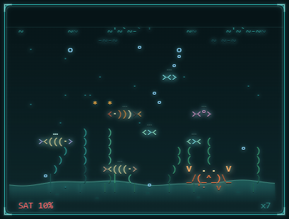
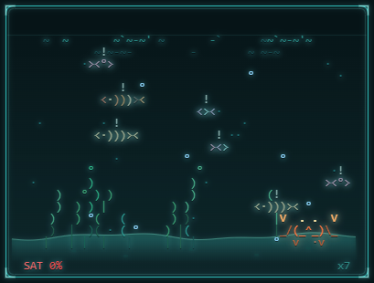

# 赛博鱼缸 · ASCII Cyber Aquarium

浮在 Windows 桌面上的 ASCII 鱼缸桌宠。无边框、无标题栏、**背景全透明**——桌面上只看得见字符和那圈辉光，没有底板、没有窗口。


## 两种用法

**直接玩**：到 [Releases](../../releases) 下载 `CyberAquarium-portable.zip`，解压到**纯英文路径**（例如 `D:\CyberAquarium`），双击里面的 `赛博鱼缸.exe`。
（Electron 从含中文的路径启动会直接崩溃，所以路径必须英文；启动器会先检查并提示。）

**改代码**：见下面的[开发环境](#开发环境)。

> 📘 完整图文说明书在 [说明书.html](说明书.html)（单文件、内嵌截图、双击即可打开，可直接打印）。

## 开发环境

```bat
git clone https://github.com/<your-name>/cyber-aquarium.git
cd cyber-aquarium
```

程序本体在 `cyber-aquarium/`，运行时单独放（**Electron 的 exe 路径必须是纯英文**）：

1. 下载 Electron 45.x win32-x64，解压到项目里的 `runtime\`（能看见 `runtime\electron.exe` 就对了）
   - 这目录 285 MB，`.gitignore` 里已经排除，不会进仓库
2. 不想放在项目里，就设环境变量 `AQ_RUNTIME` 指向别处的 runtime 目录（必须是纯英文路径）
3. 双击项目根目录的 `赛博鱼缸.exe`；要看报错就用 `tools\启动赛博鱼缸-调试.cmd`

跑自检（合成事件跑一遍交互回归）：

```cmd
"runtime\electron.exe" "cyber-aquarium" --selftest --capture="shots\test.png"
```

打发布包（精简运行时 + 打 zip，输出到 `dist/`）：

```cmd
tools\重新打包.cmd
```

## 操作

| 动作 | 效果 |
| --- | --- |
| **点水面** | 在那个位置撒 **1–3 颗**鱼食，各自散开；**一颗食同一时间只归一条鱼**（认领 2.5 秒），所以不会七条鱼叠成一个 |
| **点在鱼身上** | 把那条鱼惊走：它闪一下白、3.2 倍速窜出一段、拖一串气泡。**这一下不投食** |
| **鼠标停在鱼身上不动** | **摸它**：鱼会停下来，头顶冒一串小 `♥`（每只鱼性格不同，见下面「摸摸鱼」） |
| **点在螃蟹身上** | 它会**夹你一下**（钳子合上、闪亮黄），然后横着窜开、扬一把沙。**不投食** |
| **鼠标在水里晃** | 附近的鱼会转过来看着光标，慢慢跟着游——可以用鼠标把鱼群赶着走 |
| **按住拖** | 拖动整个鱼缸。**不吸附**，随便放到哪都行；只要至少留 48px 在屏幕里 |
| **右键** | 打开菜单（菜单的**唯一**入口） |
| **Esc** | 关菜单 |

点菜单外面也会收起菜单，而且那一下不会再触发喂食。

喂食和拖动是同一个手势，靠 **4px 位移阈值**区分：按下没动就松手 = 喂食（或点鱼），按下拖动 = 搬鱼缸。这套判定直接学的 `dsh-whale-widget`（它用 `drag.moved` + `CLICK_SQ` 做同样的事），只是把"document 级指针监听"换成了窗口内的指针捕获。

光标会跟着区域变：水里是 `crosshair`、外面是 `grab`、拖动时是 `grabbing`。

## 菜单


右键弹出的菜单，四段分组：

```
撒一把鱼食          ← 6 颗，不判断饿不饿
再加一条鱼          ← 满 8 条置灰
捞走一条鱼          ← 只剩小丑鱼时置灰
──────────
换一缸清水          ← 只清鱼食，水草不动
换一缸水草          ← seedPlants() 重长 + 顺手清鱼食
──────────
尺寸                ← 标题单独一行
──────────
深色模式  ✓
总在最前  ✓
──────────
使用说明            ← 用系统默认程序打开 说明书.html
──────────
退出
```

- 尺寸用 `row` 型菜单项渲染：`buildMenu()` 里生成 `.menu-row` + 三个 `.dot` 按钮
- 可用性由 `refreshMenuState()` 每次打开时刷新（加鱼/捞鱼置灰、尺寸点亮、勾选状态）
- 点任何一项都立即关菜单（`applySize` 自己关，其它项走 `runAction` 末尾）
- 鱼食寿命 45 秒，所以换水前能看着它慢慢沉一会儿

实现细节：

- **尺寸**：352×264 / 409×310 / 523×402。切换时窗口和可点击区域一起变（不是只缩画面）。Electron 在 `resizable:false` 的窗口上会静默忽略 `setSize`，所以是"临时允许缩放 → 改 → 关回去"
- **深色模式**：在画布下面铺一层纯色底（`body.dark { background-color: #061417 }`），画布保持透明，所以辉光会透在底色上；缸内内容一个像素都不改
- **换一缸清水 / 换一缸水草**：都在 `runAction()` 里。`clear` 只 `model.pellets.length = 0`；`scape` 调 `seedPlants()` 重新生成 9 株（位置/高低/形态/色调全随机），顺手也清鱼食
- **总在最前**：勾选状态实时生效，走 `window.aq.setTop()`
- **使用说明**：`shell.openPath()` 打开程序目录上一级的 `说明书.html`（开发布局在项目根，发布包里和 exe 同级）；走 `aq:manual` IPC，preload 暴露 `openManual()`
## 鱼的性格

性格跟鱼的**形态**绑定：

| 形态 | 性格 | 对鼠标的反应 |
| --- | --- | --- |
| `><(((·>`（橙白条纹） | **小丑鱼** | **互动最强**：你动不动它都凑过来，绕得更近（约 2.2 格）、更快，顺手还会绕圈。**保底一条，捞鱼捞不走它** |
| `><>` | **胆小** | 你靠近到 7 格内，它转头加速逃开，边跑边冒泡 |
| `><°>` | **好奇** | 你**停住不动** 1.2 秒后才感兴趣，游过来**绕着光标转圈**（保持约 3 格半径） |
| `><(((·>` | **被动** | 只理**正在移动**的光标，慢慢凑近；你手一停它就失去兴趣走开 |

不管哪种性格，**点在鱼身上都会被惊走**（闪白 + 窜开 + 一串气泡），这是直接"戳"它，不投食。

## 小螃蟹


沙线上住着一只小螃蟹，只会**横着走**，不会游进水里，每次启动换个落脚点：

```
V  . .  V      醒着：上面一行是抬起来的钳子，中间两个点是眼睛
_/(_^_)\_      身子：拱顶壳 (_^_) + 两侧折角腿 _/ 和 \_
  v   v        两只脚；走路时一抬一落（抬起那条画成 ' ），步伐按走过的距离累计

 >  - -  <     睡着：整只往下一格蹲在沙面上，脚收起来，钳子合上，眼睛闭成两条短横
_/(_^_)\_
```

夹人时上面那行变成 `>  . .  <`（钳子合上、闪亮黄），**没有叹号**——动作本身够了。

心情到点随机换（`pickCrabMode()`：32% 睡觉、44% 溜达、真来劲才 24%）：

| 心情 | 表现 |
| --- | --- |
| **睡觉** | 整只往下一格**蹲在沙面上**：脚收起来、钳子合上（`>  - -  <`）、眼睛闭成短横，睡 7~16 秒 |
| **自己溜达** | 走两下、站一会儿（站住时脚不动），走动时踢起几粒沙 |
| **让一让** | 别的鱼贴着沙面游过来时，`yieldToFish()` 按概率横着挪开；睡着时只有很小几率被蹭醒让路（`stats.yields` 计数） |
| **跟着你** | 钳子朝你那边指着，往光标那边横着挪（2.0 格/秒，光标 12 格内才来劲） |
| **躲开你** | 钳子乱挥，朝反方向跑（3.4 格/秒）；被点过之后也会切到这一档 |

点它 → `model.stats.pinches++`，钳子"啪"地合上（`>  . .  <`）＋ 闪一下亮黄，0.75 秒后横着窜开。
它**吃不到也不吃**鱼食（`stepCrab` 里根本不看 `model.pellets`），所以把鱼食按在它脚边它也不会动。

**逗螃蟹时小丑鱼会识趣**：`teasingCrab()` 判定「光标贴在螃蟹左右 7 格内且在下层水域」或「刚夹完的半秒」，
这期间最爱凑热闹的小丑鱼 `stepCursorPull` 直接返回 false，不跟过来；如果它本来就在 6 格内，会自己往后退一点。
光标挪开之后照旧贴上来——这就是为什么逗螃蟹的时候画面干净。

小丑鱼是整个缸里**颜色最艳**的一条：高饱和橙红（`#ff2d00` → `#ff7a00`）+ 暖黄白条 + 深色眼睛，身后的柔光也比别的鱼更浓更暖。白条用暖米黄而不是纯白——窗口是透明的，纯白字符在浅色壁纸上会"消失"；眼睛是一个深色点，保证任何背景都能认出它。

## 鱼撞鱼 / 鱼撞螃蟹

挤到一起时**不会闪白也不会窜走**，只是各自换个深度错开、速度慢半拍，像"哎我碰到你了"：

- 迟钝：要撞上一小会儿才反应过来（每帧概率触发，不是一碰就弹）
- 鱼×鱼：两条各自往相反方向让开半个身位，闷一下气泡
- 鱼×螃蟹：鱼贴着沙面游到螃蟹背上会往上让开，螃蟹自己也会挪
- 冷却 3 秒，避免连续抖

这比"被点/被摸"弱很多 —— 点它是吓，摸它是享受，撞一下只是打个照面。

## 摸摸鱼

**慢 = 摸，快 = 吓**。同一只鱼同一个位置：

| 手势 | 判定 | 反应 |
| --- | --- | --- |
| 点一下（按下即松，位移 < 4px） | 惊吓 | 闪白 + 3.2 倍速窜 + 拖气泡 |
| 压在鱼身上**停住** ≥ 0.3~0.6 秒（看性格） | **抚摸** | 鱼停下、轻浮，头顶冒 `♥` |
| 在鱼身上快速划过 | 惊吓 | 同上，等于蹭到了 |
| 停在空水里 | 逗鱼 | 按性格：逃 / 凑 / 追 |

- 判定靠 `cursor.stamp`（最后一次移动的时间）：手不动 1 秒它就知道你在摸它
- **睡着的鱼摸不动**：摸它不出爱心、也不醒，只有**点一下**才把它叫醒（然后照旧被吓到窜开）
- 性格决定门槛和节奏：小丑鱼要停 **0.45 秒**才认、爱心间隔 **0.62 秒**起步；胆小的要 **0.85 秒**才敢让你摸、爱心 **0.95 秒**起步
- 每个爱心之间会再乘一个 0.8~1.55 的随机数，所以节奏不是"哒哒哒"，是一颗一颗冒
- 摸够 **2.5 秒**它就摆尾游走，冷却 10 秒（"摸够了"）
- **饿到 15 以下摸不出爱心**，只冒一个灰色的 `…`；这时候你就是在安慰它


## 全局速度

所有鱼的动作（巡航 / 加速 / 受惊 / 追食 / 性格反应）都乘同一个 `FISH_SPEED = 0.85`，比例不变、整体慢 15%。想更慢把它改成 0.8。

## 饿了会怎样

**四档，一眼能分出来**（`hungerTier()`）。除了游速，每档还有自己的表情符号、色阶和底栏记号：

| 档位 | SAT | 游速 | 头顶 | 颜色（往灰青混） | 底栏 |
| --- | --- | --- | --- | --- | --- |
| 正常 | ≥ 40 | ×1.0 | 无 | 0% | `SAT 92%` 青色 |
| 饿 | < 40 | ×0.9 | `…`，**9~18 秒才来一次** | 18% | 数字土黄，`SAT` 字样也偏黄 |
| 很饿 | < 15 | ×0.65 | `…`，2.5~4.5 秒一次、挂 2.4 秒；**SAT < 5 时变 `!`** | 46% | 数字红色，`SAT` 字样也变红 |
| 饿坏了 | = 0 | ×0.45 | `!`，1.6~3 秒一次 | 72% | 深红，**低于 5 开始闪** |

**吃的欲望 = 食欲 × 贪吃程度**（`wantsPellet()`）：SAT ≥ 99 一口都不吃；SAT < 15 全缸必来；中间按 `(1 - SAT/100) × 贪吃系数` 掷骰子，每条鱼对同一颗食只掷一次。贪吃系数：小丑鱼 1.25、好奇 1.0、被动 0.95、胆小 0.8，再乘个体随机 0.85~1.2。

吃完一颗鱼会歇 **6~12 秒**，这段时间不再抢食，所以一条鱼不会把一缸食吃光。




**追食速度也跟着饿的程度走**：正常 1.9 倍速、饿 2.2、很饿 2.6、饿坏 3.0 —— 撒食时一眼看出谁最急。

**饿坏了还会往下沉**：`targetY` 被压到缸底那两行，所以整缸鱼会贴到沙面附近打蔫，跟平时的分层游动一眼区分开。



数字紧挨着 `SAT` 排，后面不带标点；`SAT` 低于 5 时数字会一亮一暗地闪。

颜色是**渲染时临时混**的（`fishCharColor` 里算），不写回鱼的出生配色——喂一颗食立刻按新饱食度重算，恢复一档；饿到 0 时鱼仍然照吃不误。
## 界面

| 透明（默认） | 深色模式 |
| --- | --- |
|  |  |
| 叠在壁纸上，壁纸会透过来 | 画布下面铺一层 `#061417` 纯色底 |

- 网格是 **55×22** 个格子（`7×13px` 一格），所以字符很小、细节比块状 ASCII 多得多
- 水面在**水的第一行**（`~ - ' ` 混排，三组正弦 + 逐列抖动画成），**第二行只留较高的波峰、颜色更暗**，两行叠出往下淡出的过渡；水面以上是空气，保持纯透明
- 水草是分节摆动的：每株的摆幅、速度、色调单独随机，梢部还会挂一个小花苞 `°`；鱼游过去会**顺着游动方向**把草带一下，再慢慢弹回来
- 缸内有一层**极淡的青灰底**，**只铺在水面以下**且越往上越淡（`rgba(10,44,50)` 从水面 1.5% 渐到底部 14%）——水波上方是空气，保持纯透明，跟真鱼缸一样
- **鱼是画面主角**：鱼的字形本身带同色发光（`shadowBlur` 只作用在鱼的字符上，其它元素不发光），所以能从满缸的细线条里跳出来又不会糊成一团
- **鱼的上色是随机的**：约六成是彩色（头尾跳色的双色鱼、或逐段换色的彩虹鱼），四成是单色。**颜色出生就定死**——游到哪一层、睡不睡都不变色，只有被你戳那一下会闪白
- **鱼有四种状态**，自己会切换：闲游、停住发呆（原地浮沉）、突然加速、睡觉（**悬停在原处**、头顶飘 `z`；约三分之一的鱼是贴着沙面睡的那种）。被喂食、被鼠标吸引、被点一下都会把它叫醒
  - 睡觉不会往下掉——真实鱼靠中性浮力和鳍保持深度，自由下沉/侧翻多半是病了（见 [PetMD](https://www.petmd.com/fish/behavior/do-goldfish-sleep)、[World Book](http://www.worldbook.com/Shared/landing%20pages/Licensing/World-Book-Text-Structure-and-Features.pdf)）
- **第一次启动**（还没有存档时）SAT = 4：小鱼一出来就是"饿坏了"（头顶冒 `!`、底栏闪红），等你喂；之后完全按存档走，不会重置
- 底栏左边 `SAT 57%` 是**饱食度**：鱼每吃掉一颗鱼食 **+1**，随时间线性下降，满 100 点约 5 小时归零；低于 45% 变琥珀色，低于 20% 变红色，**低于 5 开始闪**
- 底栏右边 `x3` 是缸里当前的鱼数（1–8 条）
- 气泡从**鱼嘴**冒出（行进方向最前面那个字符），不是从身体中间；水底那串是植物和沙床自己冒的
- 帧率 15fps，空闲时约占单核 19%、内存约 340MB（Electron 的地板）

## 状态存在哪

`%APPDATA%\cyber-aquarium\state.json`，存位置、尺寸、外壳（透明/深色）、饱食度、鱼数、是否置顶。

- 饱食度会自然衰减：满 100 点大约 5 小时掉到 0
- 关掉再开也会继续饿——按存档时间补算离线衰减
- 想从头养：删掉这个 json 就行

## 目录

```text
cyber-aquarium/
├── README.md
├── LICENSE
├── 赛博鱼缸.exe                # 启动器（内嵌图标，双击即用）
├── 说明书.html                 # 图文说明书（生物图鉴风格，截图内嵌）
├── 使用说明.txt                # 给玩的人的一页纸
├── cyber-aquarium/            # 程序本体
│   ├── package.json
│   ├── main.js                # 窗口、透明置顶、拖动、越界保护、尺寸、存档、菜单 IPC
│   ├── preload.js             # contextBridge 暴露 IPC
│   └── renderer/
│       ├── index.html
│       ├── style.css          # 透明背景 + 辉光
│       └── app.js             # ASCII 世界：鱼的 AI、螃蟹、水草、气泡、HUD、交互、菜单
├── assets/aquarium.ico        # 图标（桌面快捷方式用）
├── shots/                     # 截图（README 用；说明书里是内嵌 base64）
├── tools/
│   ├── 启动赛博鱼缸-调试.cmd   # 开发用：保留控制台，能看到 Electron 的报错
│   └── 重新打包.cmd            # 生成 dist/CyberAquarium-portable.zip
├── runtime/                   # Electron 运行时（285 MB，.gitignore 排除）
└── dist/                      # 打包产物（.gitignore 排除）
```

## 想改点什么

| 想改 | 位置 |
| --- | --- |
| 鱼的种类、颜色、游速 | `cyber-aquarium/renderer/app.js` 顶部的 `KINDS` |
| 整体配色 | 同文件顶部的 `P` 对象 |
| 格子尺寸 / 字号 / 内边距 | `cyber-aquarium/main.js` 的 `LAYOUT.sizes` |
| 喂食手感、拖动阈值 | `renderer/app.js` 的 `DRAG_SQ` 和 pointer 段 |
| 衰减速率 | `renderer/app.js` 的 `step()` 里 `100 / (5 * 3600)` |

改完直接重启鱼缸即可（没有编译步骤，纯 JS）。

## 关键参数

全在这两个文件里：`renderer/app.js`（模拟与绘制）和 `main.js`（窗口）。改完 `tools\启动赛博鱼缸-调试.cmd` 直接看效果。

单位说明：速度是**格/秒**（1 格 = 7×13px，medium 尺寸下整缸 55×22 格）。

### 节拍与网格

| 参数 | 当前值 | 作用 |
| --- | --- | --- |
| `FRAME_MS` | `1000/15` | 15fps，`dt` = 1/15 秒 |
| `COLS × ROWS` | 55 × 22 | 网格；水层 2~19、沙面 20、HUD 21 |
| `LAYOUT.sizes` | small 6×11 / **medium 7×13** / large 9×17 | 格子尺寸和前后面距 |
| `DRAG_SQ` | 16 | 位移 < 4px 算点击，否则算拖窗口 |

### 鱼的本体

| 参数 | 当前值 | 作用 |
| --- | --- | --- |
| `FISH_SPEED` | **0.85** | 全局鱼速，乘在 `base` 上（改这一个就整体快慢） |
| `KINDS[].base` | 青鳍 2.6 / 粉点 2.2 / 黄带 1.9 | 各鱼基础速度 |
| `CLOWN.base` | 2.4 | 保底小丑鱼 |
| `FISH_MODES` | cruise 5(4~10s) / idle 3(1.6~4.2s) / burst 2(0.9~2.2s) / sleep 2(7~16s) | 权重 + 时长 |
| burst 倍速 | ×2.9 | 突然窜一下 |
| 上下巡航 | 0.8 格/s | `targetY` 追赶速度 |
| 边界 | minX 1.25，maxX 53−身长 | 不出框 |
| 睡觉下沉 | 贴底 0.42 / 悬停 0.2 | 格/s |

### 性格（对鼠标）

| 性格 | 触发条件 | 速度 |
| --- | --- | --- |
| `shy` 胆小 | 5.5 格内 | 反向 2.1×base，垂直 0.7 |
| `still` 好奇 | 光标静止 ≥1.8s 且 11 格内 | 环绕 0.9×base / 纵 0.5×base，轨道半径 3.4 |
| `calm` 被动 | 光标动过 ≤0.7s 且 6.5 格内 | 靠近 0.4×base |
| `clown` 小丑鱼 | 14 格内一直跟着 | 环绕 1.3×base / 纵 0.7×base，轨道半径 2.2 |

### 受惊 / 碰撞

| 参数 | 当前值 | 作用 |
| --- | --- | --- |
| 受惊时长 / 倍速 | 1.1s / 3.2×base | 点鱼、快速划过 |
| 受惊气泡 | 每 0.06s | 拖一串 |
| 碰撞时长 | 鱼×鱼 0.55s / 鱼×蟹 0.6s | 让开 |
| 碰撞位移 | 上下 1.15 格/s，前进 55% | 幅度很小 |
| 碰撞冷却 / 触发率 | 3s / `dt×5`（鱼×鱼）、`dt×4`（鱼×蟹） | 越大越迟钝 |

### 抚摸与爱心

| 参数 | 小丑 | 被动 | 好奇 | 胆小 |
| --- | --- | --- | --- | --- |
| `PET.dwell` 停多久才认 | 0.45s | 0.55s | 0.6s | 0.85s |
| `PET.heartGap` 爱心间隔 | 0.62s | 0.85s | 0.78s | 0.95s |

| 其它 | 值 |
| --- | --- |
| 间隔随机乘数 | `rand(0.8, 1.55)` |
| 摸够 / 冷却 | 2.5s / 10s |
| 摸不出爱心的门槛 | `PET.minSat` = 15 |
| `HEART` | 字符 `♥`，寿命 1.15s，上升 1.7 格/s，同屏上限 12 |

### 饥饿

| 参数 | 当前值 | 作用 |
| --- | --- | --- |
| 衰减 | `100/(5*3600)` | 每秒 0.00556，5 小时归零；离线也补算 |
| `HUNGER` | 40 / 15 / 0 | 饿 / 很饿 / 饿坏的阈值 |
| `HUNGER_SPEED` | `[1, 0.9, 0.65, 0.45]` | 平时游速系数 |
| `CHASE_SPEED` | `[1.9, 2.2, 2.6, 3.0]` | 追食倍速（越饿越急） |
| `HUNGER_GREY` | `[0, 0.18, 0.46, 0.72]` | 往 `#6b8f8f` 混多少 |
| `HUNGER_EMOTE_GAP` | `[—, 9~18s, 2.5~4.5s, 1.6~3s]` | 头顶 `…` 的频率；< 5 换 `!` |
| 表情显示时长 | 1.8s（很饿 2.4s） | |
| `APPETITE` | `full 99` / `ravenous 15` | ≥99 不吃；<15 全来 |
| `GREED` | 小丑 1.25 / 好奇 1.0 / 被动 0.95 / 胆小 0.8 | ×`rand(0.85,1.2)` |
| `DIGEST` | `[6, 12]` 秒 | 吃完歇一会，不抢食 |
| 一颗鱼食 | **+1** | 饱食度 |

### 鱼食

| 参数 | 当前值 | 作用 |
| --- | --- | --- |
| 下沉 / 横漂 | 1.6 格/s / 0.35 | 落点 19.65 行 |
| 寿命 / 上限 | 24s / 24 颗 | |
| 点击撒 | 1~3 颗；菜单 6 颗 | |
| `CLAIM_TTL` | 2.5s | 一颗食只归一条鱼 |
| 咬合位 | ±1.2 格 | 每条鱼自己的站位 |
| 吃食判定 | dx < 1.6 且 dy < 1.15 | |

### 气泡 / 尘 / 水草 / 沙

| 参数 | 当前值 |
| --- | --- |
| 气泡上升 / 上限 | 1.2~2.4 格/s / 44 |
| 悬浮尘 | 16 颗，漂 ±0.16 |
| 水草 | 9 株，被鱼带 ±2.0，跟随 3.5/s |
| 螃蟹踢沙 | 上限 18 颗 |

### 螃蟹

| 参数 | 当前值 | 作用 |
| --- | --- | --- |
| 位置 / 宽度 | 第 18 行 / 9 格，活动 1.5~43.5 | |
| 行为权重 | 睡 32%(7~16s) / 溜达 44%(5~11s) / 追 15%(1.2~2.4s) / 逃 9%(0.8~1.6s) | `pickCrabMode` |
| 速度 | 追 2.0 / 逃 3.4 / 躲 2.6 / 溜达 0.75（sin 绝对值 < 0.6 时为 0） | |
| 靠近判定 | 光标水平 ≤12 格 | |
| 夹人 | `pinch` 0.75s | |
| 给鱼让路 | `dt×2.2`（睡着 `dt×0.18`） | |

### 窗口与存档

| 参数 | 当前值 | 作用 |
| --- | --- | --- |
| `DEFAULT_STATE` | satiety **4**、fishCount 3、medium、clear、置顶 | 首次运行 |
| 存档间隔 | 5s | 写 `%APPDATA%\cyber-aquarium\state.json` |
| 菜单项 | 10 个 | `MENU_ITEMS` |

## 开机自启

`Win+R` → 输入 `shell:startup` → 回车 → 把 `赛博鱼缸.exe` 的**快捷方式**丢进去。

## 已知限制

- **只在 Windows 上做过**，透明窗口靠 Electron，别的系统没验证
- **Electron 运行时的路径必须是纯英文**：`runtime\` 所在的整条路径不能有中文，因为 Electron 从含中文的路径启动会直接崩溃（退出码 `0x80000003`，连 `--version` 都打不出来）
- 没有托盘图标，退出走右键菜单
- 不吸附，可以随便摆；但整块拖出屏幕会被拉回来，至少保留 48px 可见（防止找不回来）
- 窗口是矩形，鱼缸四个圆角外那点透明区域仍然会接住点击（还没做逐像素穿透）
- **拖动时每步都必须用 `setBounds`（带尺寸）**：在 175% 缩放的屏幕上，只调 `setPosition` 会让窗口每次长 1~2px（DIP↔物理像素取整累积），10ms 一步就是每秒 100~200px。透明外壳看不出来，深色外壳就变成"背景一层越拖越大"。所以拖动期间临时 `setResizable(true)` + `setBounds`，松手再 `setResizable(false)` 并把尺寸写回标准值

## 开发自检

程序内置了几个一次性验收开关，都是用 `electron.exe <程序目录> <开关>` 跑：

| 开关 | 作用 |
| --- | --- |
| `--capture=<png>` | 截图后退出（透明像素保留 alpha） |
| `--selftest` | 合成事件验证「点击→喂食」「点鱼→惊走」「光标吸引」「拖动起止」「右键开关菜单」「点螃蟹→夹人」「螃蟹不吃鱼食 / 跟随 / 躲开」「逗螃蟹时小丑鱼不来」并打印结果 |
| `--probe` | 打印当前字体、格子宽度、字形墨迹宽度 |
| `--fps` | 打印实测帧率、去掉辉光后的帧率、单帧绘制耗时 |
| `--dump` | 把内部字符网格按行打印出来 |
| `--feed` / `--menu` | 截图前先撒食 / 打开菜单 |
| `--crab` / `--crabsleep` / `--crabclear` | 截图前先点一下螃蟹（定格夹人那帧）/ 按进睡姿 / 鱼赶到一边只拍螃蟹 |
| `--clear` | 截图前强制透明外壳（否则跟着存档的深色模式走） |
| `--hungry` / `--pet` | 截图前把饱食度清零（看饿坏的样子）/ 把光标停在鱼身上（看爱心） |

例：

```cmd
"runtime\electron.exe" "cyber-aquarium" --selftest --capture="shots\test.png"
```

## License

代码以 MIT 发布（见 `LICENSE`）。运行时要单独准备，不随仓库分发；Electron / Chromium 的许可见它们自己的 `LICENSE`、`LICENSES.chromium.html`。

---
