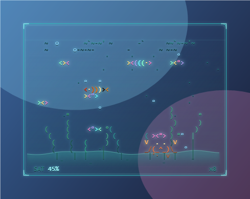
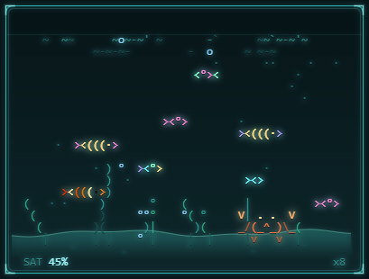
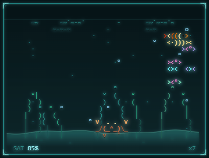
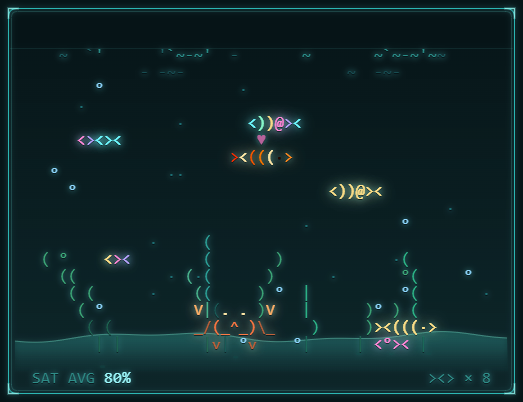
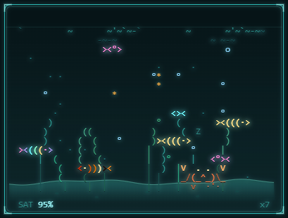
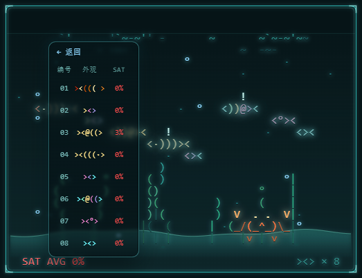

# 赛博鱼缸 · ASCII Cyber Aquarium

浮在 Windows 桌面上的 ASCII 鱼缸桌宠：无边框、无标题栏、背景全透明——桌面上只看得见字符和那圈辉光。Electron + Canvas 2D，55×22 个字符格，15fps。


`v1.3.0` · MIT · Windows 10/11 x64 · [Releases](https://github.com/PanXingcheng01/cyber-aquarium/releases) · [用户手册](用户手册.html)

1.3 主题与效果：主题决定外壳和调色板，扫描线等效果可独立叠加；主题包放在游戏目录的 `plugins/themes`。

## 下载与上手

> 不想看代码，只想养鱼：按下面四步走。

1. 打开 [Releases](https://github.com/PanXingcheng01/cyber-aquarium/releases)，在 **Assets** 里下载 `CyberAquarium-v1.3.0-setup.exe`（安装版）或 `CyberAquarium-v1.3.0-portable.zip`（便携版）。
   - **不要下 `Source code`**，那是源码快照，不能直接玩。
2. 解压到**纯英文路径**，例如 `D:\CyberAquarium`。
   - 路径里只要有中文（或其它非英文字符），Electron 会直接崩溃；启动器会先弹窗提醒。
3. 双击 `启动赛博鱼缸.exe`。
   - 第一次启动 SAT 只有 4%，右键 →「撒一把鱼食」；想从头养就删掉 `%APPDATA%\cyber-aquarium\state.json`。
4. 玩法看包里的 **`用户手册.html`**（图文、带目录，双击即开）和 **`快速上手.txt`**（一页纸 / FAQ）。

> 更新已有安装：覆盖 `app/`、`启动赛博鱼缸.exe`、`快速上手.txt`、`用户手册.html`；`runtime/` 没换 Electron 时可以保留。`plugins/themes` 里玩家自己添加的主题不会被新包覆盖；不要删除整个 `plugins` 文件夹。存档在 `%APPDATA%\cyber-aquarium`，不会被覆盖。

系统要求：Windows 10 / 11（64 位）；不用装 Node、不用联网、不需要管理员权限。程序没有数字签名，首次运行 SmartScreen 提示时选「更多信息 → 仍要运行」。

## 开发环境

程序本体在 `app/`，Electron 运行时单独放——**exe 所在整条路径必须是纯英文**。

```bat
git clone https://github.com/PanXingcheng01/cyber-aquarium.git
cd cyber-aquarium
```

1. 下载 Electron 45.x win32-x64，解压到 `runtime\`（能看到 `runtime\electron.exe` 即正确）。该目录约 285 MB，已在 `.gitignore` 中排除。
2. 不想放在项目里，就设环境变量 `AQ_RUNTIME` 指向别处的 runtime（同样必须纯英文）。
3. 启动方式：
   - 双击根目录 `启动赛博鱼缸.exe`（启动器，自动找 `runtime\` 和 `app\`）
   - `tools\launch-debug.cmd`（保留控制台，能看到 Electron 报错）
   - `runtime\electron.exe app`（直接启动程序本体）

## 代码结构

```text
cyber-aquarium/                  # 仓库根
├── app/                          # 程序本体（与发布包 app/ 同名）
│   ├── main.js                  # 主进程：窗口、拖动、尺寸、存档、IPC、截图/自检
│   ├── preload.js               # contextBridge → window.aq
│   └── renderer/
│       ├── index.html
│       ├── style.css            # 透明背景、辉光、菜单
│       ├── fish-data.js         # 品种 / body / 配色 / 体长系数数据
│       └── app.js               # 模型、step、draw、输入、菜单
├── tools/
│   ├── launcher.cs              # 启动器源码（csc 编译进 启动赛博鱼缸.exe）
│   ├── build.cmd                 # 版本注入、runtime 瘦身、打 zip
│   └── launch-debug.cmd
├── assets/aquarium.ico
├── shots/                       # README 截图
├── 用户手册.html                # 玩家图文手册
├── 快速上手.txt                 # 玩家一页纸
├── runtime/                     # Electron 45.3.2（gitignore）
```

| 文件 | 职责 |
| --- | --- |
| `main.js` | 透明/无边框/置顶窗口、拖动与越界保护、尺寸切换、`state.json` 读写、菜单 IPC、截图与自检 |
| `preload.js` | `contextBridge` 暴露 `window.aq`：`load/save/dragStart/dragEnd/setSize/setTheme/setTop/openManual/quit` |
| `renderer/app.js` | 整个模拟与绘制：鱼/螃蟹/水草/鱼食/气泡/爱心、`step`、`draw`、输入手势、菜单 DOM |
| `renderer/fish-data.js` | 品种、允许的 body 变体、配色样式、`BODY_SIZE` 体长系数；不含逻辑 |
| `renderer/style.css` | 透明外壳、辉光、菜单样式 |
| `tools/launcher.cs` | 启动器：找 runtime 和 app、检查纯英文路径、启动 Electron |
| `tools/build.cmd` | 版本号注入、runtime 瘦身、打 zip、归档旧版 |

IPC 通道：

| 通道 | 方向 | 作用 |
| --- | --- | --- |
| `aq:load` / `aq:save` | renderer → main | 读 / 写存档 |
| `aq:drag-start` / `aq:drag-end` | renderer → main | 拖动开始 / 结束（主进程用 `setBounds` 跟指针） |
| `aq:set-size` / `aq:theme` / `aq:top` | renderer → main | 尺寸 / 深色外壳 / 置顶 |
| `aq:manual` / `aq:quit` | renderer → main | 打开用户手册 / 退出 |

## 运行与存档

存档在 `%APPDATA%\cyber-aquarium\state.json`：

- 找法：`Win+R` → 输入 `%APPDATA%\cyber-aquarium` → 回车；或在资源管理器地址栏粘贴这一行。
- 完整示例：`C:\Users\你的用户名\AppData\Roaming\cyber-aquarium\state.json`。

```json
{
  "x": 0, "y": 0,
  "size": "medium", "theme": "clear",
  "satiety": 72, "fishCount": 3,
  "fish": [
    { "id": 1, "species": "clown", "bodyId": "clown-standard", "body": "><(((·>", "color": "#ff5a00", "paint": "clown", "accent": "#ffe9a8", "hue": 0, "greed": 1.1, "satiety": 72, "rest": false }
  ],
  "sandSeed": 421,
  "plants": [
    { "x": 12.4, "h": 6, "tone": 2, "amp": 2.5, "rate": 0.45, "bud": true }
  ],
  "alwaysOnTop": true, "savedAt": 0
}
```

- 每 5 秒自动保存一次；页面隐藏和 `beforeunload` 时也会保存。
- 每条鱼的饱食度：静止基础消耗 `100 / (5 * 3600)` 每秒，再按实际游速追加；受惊瞬间另扣 0.35。静止满 100 约 5 小时，游得越快掉得越快；启动时按 `savedAt` 逐鱼补算离线衰减，**离线速度是开着的 1/10**（约 2 SAT/小时，100 点约 50 小时）。
- 首次启动（没有存档）：SAT=4、3 条鱼、medium、透明外壳、置顶。
- 每条鱼的种类、颜色样式、贪吃程度、睡姿和当前 SAT 存在 `fish` 里；重启不会换鱼。旧存档没有 `fish` 时按 `fishCount` 随机补一次，之后固定。
- `sandSeed` / `plants` 保存沙面纹理和水草基础外形；旧存档没有时首次启动随机一次并写回，之后重启保持。摆动相位、鱼/螃蟹的运行时位置和姿态不存，重开后自然不同。只有「换一缸水草」会重新抽沙面、重长水草。
- `body` / `color` 是显式存档，不再只从 `species` 推导；以后改品种表不会改老鱼的样子。`species` 决定行为，`body` 决定字形，配色字段决定颜色。
- 窗口位置和尺寸也在这里；删掉文件即恢复默认。

## 行为模型

每帧 `step(dt)` 更新鱼、螃蟹、鱼食、气泡、水草、爱心；`draw()` 把字符网格画到 canvas。所有鱼的动作都乘 `FISH_SPEED = 0.85`。

### 鱼的状态

| 状态 | 权重 / 时长 | 行为 |
| --- | --- | --- |
| `cruise` | 5 / 4~10s | 巡航，`targetY` 以 0.8 格/s 追赶 |
| `idle` | 3 / 1.6~4.2s | 原地浮沉 |
| `burst` | 2 / 0.9~2.2s | 速度 ×2.9 |
| `sleep` | 权重按性格 / 7~16s × 体型 | 悬停或贴沙面，头顶飘 `z`；喂食、点击能叫醒，睡着时忽略鼠标/抚摸/碰撞 |

睡眠权重：胆小 0.8、小丑鱼 1.2、好奇 1.8、被动 2.2；大鱼睡得更久（3 格 ×0.7，7 格 ×1.1）。

受惊撞到左右边界会反弹，不会贴着看不见的墙原地闪；胆小鱼例外，会直接游出缸沿消失，惊吓结束后再游回来。边框最外列是缓冲，所有鱼都能进去。

### 性格（对鼠标）

| `temper` | 触发 | 反应 |
| --- | --- | --- |
| `shy` 胆小 | 光标 5.5 格内 | 反向逃，2.1×base，边跑边冒泡 |
| `still` 好奇 | 光标静止 ≥1.8s 且 11 格内 | 绕着光标转，轨道 3.4 格 |
| `calm` 被动 | 光标 0.7s 内动过且 6.5 格内 | 慢慢靠近，0.4×base |
| `clown` 小丑鱼 | 14 格内 | 一直跟着，轨道 2.2 格；逗螃蟹时会退开 |

### 饥饿

| 档位 | SAT | 游速 | 追食 | 表现 |
| --- | --- | --- | --- | --- |
| 正常 | ≥40 | ×1.0 | ×1.9 | 无 |
| 饿 | <40 | ×0.9 | ×2.2 | 偶尔冒 `…`，颜色偏土黄 |
| 很饿 | <15 | ×0.65 | ×2.6 | 常冒 `…`，SAT<5 变 `!`，颜色偏红 |
| 饿坏 | ≤0.01 | ×0.45 | ×3.0 | 头顶 `!`、贴底打蔫、底栏闪红 |

- 吃一颗鱼食按体长结算：3/4 格 +4~5，5/6 格 +3~4，7 格以上 +2~3；饱鱼吃完歇 `6~12s`，饿鱼休息更短，饿坏可以连着吃。
- 食欲 = `(1 - SAT/100) × 贪吃系数`；SAT≥99 不吃，SAT<15 全缸都来。
- 贪吃系数：小丑 1.25 / 好奇 1.0 / 被动 0.95 / 胆小 0.8，再乘个体随机。

### 螃蟹

| 心情 | 权重 | 速度 |
| --- | --- | --- |
| 睡觉 | 32% | 0，蹲在沙面，脚收起、钳子合上 |
| 自己溜达 | 44% | 0.75 格/s（兴奋 1.25） |
| 跟着你 | 15%（光标 12 格内） | 2.0 格/s |
| 躲开你 | 9%（光标 12 格内） | 3.4 格/s |

- 基本横着走，活动范围 1.5~43.5 格；平时约每 20~40 秒才考虑换一行（18~19 行）。
- 点它 → 夹人（`pinch` 0.75s）→ 横着窜开；**85% 会在这次逃跑过程中快速换到另一行**，15% 不换；它不吃鱼食。
- 鱼贴着沙面过来时有概率让路（`yieldToFish`）；睡着时概率很低。
- 逗螃蟹时小丑鱼会退开，不抢戏（`teasingCrab`）。

### 交互手势

| 手势 | 判定 | 结果 |
| --- | --- | --- |
| 点击水面 | 按下/松开位移 <4px，且没点到鱼/蟹 | 撒 1~3 颗鱼食 |
| 点击鱼 | 命中鱼身 | 惊吓：闪白 + 顺着当前朝向 3.2×base 冲一段 + 拖气泡 |
| 点击螃蟹 | 命中螃蟹 | 夹人 + 闪黄 + 窜开 |
| 按住拖动 | 位移 ≥4px | 拖动整个窗口（主进程 `setBounds`） |
| 停在鱼身上 | 静止 ≥ `PET.dwell`（0.45~0.85s） | 抚摸：鱼停下、冒 `♥`；睡着的鱼点一下才醒 |
| 右击鱼 | 命中鱼身 | 显示 `01 SAT xx%` 跟随标签；4 秒后消失，再右击关闭 |
| 点击 HUD SAT | 底栏 SAT 区域 | 打开「查看鱼状态」 |
| 右击空白 | `contextmenu` | 打开菜单 |

### 碰撞

- 鱼×鱼 `0.55s`，鱼×蟹 `0.6s`，各自让开半个身位，纵向 1.15 格/s。
- 冷却 3 秒；触发是每帧概率（`dt×5` / `dt×4`），不是一碰就弹。

## 渲染与界面

- 网格 55×22；medium 每格 7×13px，窗口 409×310；small 352×264，large 523×402。
- 画布保持透明，字符按网格 `put()` 进缓冲区再统一绘制；辉光只作用在鱼的字符上。
- 水面在水的第一行，第二行留波峰；水面以上是纯透明空气。
- 底栏左边 `SAT AVG xx%`（全缸平均，颜色/闪动跟最低鱼），右边 `><> × N`；右键鱼会浮出 `01 SAT xx%` 小标签，4 秒消失；点 SAT 区域或菜单「查看鱼状态」打开无边框鱼列表，点某一行会让对应鱼的外层辉光呼吸几下。
- 深色模式在画布下铺 `#061417`，画布本身仍透明。
- 帧率 15fps；空闲时约单核 19%、内存约 340MB（Electron 地板）。

<details>
<summary>界面截图（主图之外 9 张）</summary>

| | | |
| --- | --- | --- |
|  |  |  |
|  |  |  |
|  |  |  |

</details>

## 关键参数

改之前先看这里；**代码是唯一事实来源**，下表只是入口。

| 想改 | 位置 |
| --- | --- |
| 鱼种、body 变体、颜色、基础速度 | `renderer/fish-data.js` 的 `SPECIES` / `BODIES` / `LOOKS` |
| 整体鱼速 | `FISH_SPEED`（0.85） |
| 鱼的状态权重 / 时长 | `FISH_MODES`（睡眠权重看 `SLEEP_WEIGHT`，睡眠时长看 `BODY_SIZE.sleepK`） |
| 性格阈值与反应 | `stepCursorPull()` |
| 饥饿阈值 / 游速 / 追食 | `HUNGER` / `HUNGER_SPEED` / `CHASE_SPEED` |
| 食欲、贪吃、消化 | `APPETITE` / `SPECIES[].greed` / `DIGEST` |
| 一口鱼食的 SAT | `BODY_SIZE.food`（按 body 长度） |
| 所有跟体长有关的生理参数 | `BODY_SIZE`（`food` / `sleepK` / `dropK` / `glowK`；新增先加这张表） |
| 饱食度衰减 | `SAT_DRAIN` + `SAT_MOVE_DRAIN`（按实际游速） / `SAT_SCARE_COST` |
| 离线饱食度 | `OFFLINE_SAT_RATE = 0.1`（开着的 1/10） |
| 鱼食下沉 / 寿命 / 上限 | `spawnPellet()` / `stepPellets()` |
| 抚摸门槛 / 爱心 | `PET` / `HEART`（摸够 2.5s 后这条鱼单独冷静 10s） |
| 螃蟹行为 / 速度 | `CRAB` / `pickCrabMode()` / `stepCrab()` |
| 受惊 / 碰撞 | `stepFish()` / `stepBumps()` |
| 格子 / 窗口尺寸 | `main.js` 的 `LAYOUT` |
| 拖动阈值 | `DRAG_SQ`（16 = 4px） |
| 存档间隔 | `startAutosave()`（5000ms） |

当前常用值：

| 参数 | 值 |
| --- | --- |
| 帧率 | `FRAME_MS = 1000/15`（15fps） |
| 网格 | 55 × 22 |
| 窗口 | 352×264 / 409×310 / 523×402 |
| 整体鱼速 | `FISH_SPEED = 0.85` |
| 鱼数 | 1~8 |
| 鱼食 | 下沉 1.6 格/s，寿命 45s（最后 3 秒闪），上限 24 颗；按体长 +2~5 SAT |
| 饥饿衰减 | 基础 100/(5×3600) 每秒 + 游速消耗 |
| 存档 | 每 5s |
| 菜单项 | 11 组（`MENU_ITEMS`，尺寸行展开为 3 个按钮，DOM 共 13 个） |

## 更新历史

### 1.3 系列 · 水流、主题与效果

<blockquote>

<details>
<summary><strong>v1.3.0</strong> · 水流、主题与效果、主题包</summary>

- 拖拽窗口会产生二维水流，鱼、螃蟹、水草、气泡、沙尘、鱼食和水面都会跟着动。
- 水流按拖拽速度分层：低速几乎不动，高速接近满档，超过阈值有短促冲击；强水流会叫醒睡着的鱼和螃蟹。
- 鱼按体长分配水阻，小鱼不会被吹得夸张；螃蟹很重，但强纵向水流能把它托离沙面，水停后落回。
- 鱼食加入物理：横向漂、纵向托起，落在沙面后遇到强上流会被重新卷起。
- 新增透明/深色主题，菜单、鱼头标签和爱心会跟着主题换配色。
- 新增独立效果栏，扫描线可以单独开关，叠加在任意主题上；包含 CRT 扫描线、暗角、RGB 边缘和刷新带。
- 深色主题使用半透明底，水下渐变和水面高光更适合浅色桌面。
- 主题底色和效果层按鱼缸边框的 9px 圆角裁切。
- 新增主题包：`plugins/themes/*.json`，菜单「自定义主题」直接打开对应目录，模板和说明也在里面。
- 会动实体统一进 `SCENE_KINDS`：鱼、螃蟹、水草、气泡、鱼食、沙尘、沙粒、爱心；以后新增生物只加一项。
- 主题包只组合数据，不执行脚本。

</details>

</blockquote>

### 1.2 系列 · 以鱼为本

<blockquote>

<details>
<summary><strong>v1.2.2</strong> · 安装版与启动器/文档命名</summary>

- 新增 Inno Setup 安装版：per-user、无需管理员，默认安装到 `%LOCALAPPDATA%\CyberAquarium`；安装位置页始终显示，非纯英文路径会拦截。
- 桌面快捷方式名「赛博鱼缸」默认创建；开始菜单和开机自启默认不勾选。
- 主程序文件改名为 `启动赛博鱼缸.exe`；帮助文档改为 `快速上手.txt` / `用户手册.html`。
- 安装完成页展示 `快速上手.txt`；不再把 `.ico` 源文件放进安装目录。
- 卸载入口为 `扔掉鱼缸.exe`，默认保留 `%APPDATA%\cyber-aquarium` 存档；真正卸载器藏在 `.uninstall\`。
- 启动器与 setup 的文件属性同步：CompanyName 留空，产品名/描述/版权一致。

</details>

<details>
<summary><strong>v1.2.1</strong> · 饿鱼连吃、抢食和菜单撒食</summary>

- 很饿/饿坏时不再犹豫，直接吃；普通饿的开口概率额外 ×1.35。
- 饿鱼吃完休息大幅缩短（很饿 0.12~0.35s、普通饿 0.7~1.4s），可以连着吃；饱鱼仍是 6~12s。
- 同一颗鱼食不再被一条鱼独占：多条鱼可以同时盯同一颗，谁先到嘴边谁吃。
- 菜单「撒一把鱼食」从 6 颗改为 18 颗；手点水面仍是 1~3 颗。

</details>

<details>
<summary><strong>v1.2.0</strong> · 逐鱼 SAT、鱼状态页、离线饥饿</summary>

- 每条鱼独立 SAT：吃食、消耗、受惊和追食都按鱼自己算；`model.satiety` 只保留为平均兼容口。
- HUD 改为 `SAT AVG`，数值是整缸平均，颜色/闪动跟最饿的鱼；右下角显示 `><> × N`。
- 右击鱼浮出 `01 SAT xx%` 标签，跟随 4 秒；点 SAT 区域或菜单「查看鱼状态」打开无边框表格，编号/外观/SAT 居中对齐。
- 鱼状态页固定 8 行位：8 条鱼填满，鱼少时行高一致；点某一行不关菜单，对应鱼的外层辉光呼吸几下。
- 鱼数据拆到 `renderer/fish-data.js`：species 决定行为，body 变体按 species 限定，颜色独立；稳定 ID，小丑鱼固定 01。
- `BODY_SIZE` 统一体长参数：一口鱼食、睡眠时长、倒水下坠、辉光范围；小鱼吃食收益更高，大鱼更低。
- 离线也消耗 SAT，但速度为开着的 1/10；水草基础外形和沙面种子写入存档，摆动相位/鱼蟹运行时状态不存。
- 菜单背景半透明；小尺寸菜单高度会随尺寸失效重算，不再在退出下面留空。
- 螃蟹被点后夹人、横窜，约 85% 在逃跑过程中快速换到另一行。

</details>

</blockquote>

### 1.1 系列 · 交互与鱼缸手感

<!-- 新版本加在 1.1 组最上面，v1.1.x 往上叠加；1.0 单独归档。 -->

<blockquote>

<details>
<summary><strong>v1.1.3</strong> · 解压文件名修复、源码目录统一</summary>

- 打包从 Windows `tar -a` 改为 PowerShell `Compress-Archive`：zip 条目名按 UTF-8 写入，并设置 ZIP 的 UTF-8 标志（bit 11），修复部分解压工具把 `赛博鱼缸.exe` / `使用说明.txt` / `说明书.html` 显示成乱码的问题。
- 源码目录 `cyber-aquarium/` 改为 `app/`，与发布包内的 `app/` 对齐；`tools/build.cmd`、`tools/launch-debug.cmd` 和文档里的路径同步。
- `tools/重新打包.cmd` / `tools/启动赛博鱼缸-调试.cmd` 改为英文文件名，减少 cmd 和路径编码问题。
- 使用说明补了存档路径的查找方式；更新步骤改为覆盖 `app/`、`赛博鱼缸.exe`、`使用说明.txt`、`说明书.html`，`runtime/` 可保留。
- 游戏逻辑不变。

</details>

<details>
<summary><strong>v1.1.2</strong> · 睡眠、受惊、抚摸和鱼类存档</summary>

- 存档新增 `fish` 数组：每条鱼保存 `temper` / `paint` / `accent` / `hue` / `greed` / `rest`；旧存档没有该字段时按 `fishCount` 随机补一次，之后固定。
- 睡眠按性格分配权重，大鱼睡得更久；睡着时跳过鼠标吸引和鱼鱼碰撞，点击或喂食可以叫醒。
- 抚摸改为每条鱼独立的 `petCool`，不再共用全局冷却；爱心按鱼生成。
- 受惊改为沿当前 `f.dir` 往前冲；胆小鱼越过缸沿后不反弹，进入 `returning` 从墙外游回；`drawFrame()` 移到字符层之后，穿出时从边框线后面消失。
- 鱼可以活动到边框内侧最外列；鱼食最后 3 秒闪烁；右键菜单支持再次右键关闭；螃蟹活动范围收到 18~19 行，补了走路沙尘。
- 自检扩展到 44 项。

</details>

<details>
<summary><strong>v1.1.1</strong> · 换水 / 换草手感重做</summary>

- 换水、换草共用 `shuffleCreatures`：全缸叫醒、洗牌、进入兴奋状态；换草不再让旧草突然抖动。
- 鱼从落点被倒入缸中，下落速度按体长缩放：小鱼阻力大沉得慢，大鱼沉得快；落地后向两边冲散铺开。
- 水面 `surfaceKick` 抖动，波纹从落点向两侧扩散；水草被水冲得倒向一边，换草重铺沙面纹理。
- 螃蟹只换位走几步，不会整缸瞬移；换水清掉旧气泡和鱼食，换草会冒珍珠泡。

</details>

<details>
<summary><strong>v1.1.0</strong> · 摸鱼爱心、饥饿四档、食欲、碰撞和菜单重做</summary>

- 摸鱼爱心：光标在鱼身上停留触发，鱼停下并冒 `♥`。
- 饥饿分四档：正常 / 饿 / 很饿 / 饿坏；游速、追食速度、体色、表情和底栏 SAT 随档位变化。
- 食欲由 `SAT`、性格贪吃系数和个体随机共同决定；吃饱的鱼会无视鱼食，SAT 很低时全缸来抢。
- 鱼×鱼、鱼×蟹碰撞后错开半个身位，不再闪白；碰撞有独立冷却。
- 右键菜单重做：喂食、换清水、换水草、尺寸单选、使用说明、置顶、深色外壳、退出；小尺寸下菜单可滚动。
- 启动器开始写入文件版本，发布包名带版本号。

</details>

</blockquote>

### 1.0 系列 · 第一缸鱼

<blockquote>

<details>
<summary><strong>v1.0.0</strong> · 2026-11-17（永久保留）</summary>

- 最初的想法：在 Windows 桌面上放一块透明的玻璃，只看得见字符和那圈辉光。Electron 45.3.2 + Canvas 2D，55×22 个字符格、15fps。
- 鱼会自己过日子：游、发呆、突然窜一下、睡觉；保底一条小丑鱼，最多 8 条。
- 点水面撒鱼食，鱼会游过去吃；点鱼身上是戳它，会闪白窜走。
- 沙面上有只小螃蟹：横着走、会夹人、会睡觉，不吃鱼食。
- 拖透明的地方挪位置；位置、尺寸、外壳、饱食度都会记住。
- 当时还是便携 zip + `启动赛博鱼缸.vbs` 启动，后来才换成内嵌图标的 `赛博鱼缸.exe`；v1.0.0 的 Release 永久保留。

</details>

</blockquote>

## 开发自检

```cmd
:: 交互回归（当前 44 项，必须全绿；--selftest 必须配合 --capture 才会执行）
runtime\electron.exe app --selftest --capture=shots\test.png

:: 截图（保留 alpha；--force-device-scale-factor=1 让输出稳定）
runtime\electron.exe --force-device-scale-factor=1 app --size=medium --dark --rescape --capture=shots\tmp.png

:: 字体/墨迹、字符网格、帧率
runtime\electron.exe app --probe
runtime\electron.exe app --dump
runtime\electron.exe app --fps
```

> `--selftest` 写在截图流程里：不带 `--capture` 时它不会执行，窗口会一直开着。要跑回归就照上面的命令带一个 `--capture`。
> 输出里的 44 个布尔断言都应符合预期；其中 `menuAfterSecondRightClick=false` 是预期值（第二次右键应关闭菜单）。
> 跑之前先关掉正在运行的鱼缸：程序有单实例锁，第二次启动会直接退出，看起来像“什么都没发生”。

验收 / 截图开关（`main.js` 顶部解析）：

| 开关 | 作用 |
| --- | --- |
| `--selftest` | 合成事件跑交互回归（需配合 `--capture`） |
| `--capture=<png>` / `--wait=<ms>` | 截图后退出 / 截图前等待 |
| `--size=small\|medium\|large` | 启动尺寸 |
| `--sat=<0-100>` / `--hungry` | 设置饱食度 / 清零 |
| `--feed` / `--pet` / `--menu` | 撒食 / 光标停鱼身 / 打开菜单 |
| `--crab` / `--crabsleep` / `--crabclear` | 螃蟹夹人 / 睡姿 / 只拍螃蟹 |
| `--rescape` / `--water` | 换草 / 换水 |
| `--dark` / `--light` / `--clear` | 深色 / 透明（`--light` 与 `--clear` 等同） |
| `--sleep` / `--top` / `--fish=<n>` | 鱼睡觉 / 浮到水面 / 加到 n 条 |
| `--probe` / `--fps` / `--dump` | 字体墨迹 / 实测帧率 / 字符网格 |
| `--sizetest` / `--snaptest` | 尺寸切换 / 贴边不吸附（内部回归） |

## 打包与发布

### 构建

```cmd
:: 先关掉正在运行的鱼缸，否则 exe 被占用，启动器编译失败
cmd /c tools\build.cmd build
```

脚本会重新编译启动器、精简 runtime，生成带版本号的 portable zip。

### 版本更新规则

- 版本号**唯一来源**：`app/package.json` 的 `version`。zip 名、`启动赛博鱼缸.exe` 文件属性、Release tag 自动一致，不要手改 exe。
- 级别：`z` = 只调手感 / 修 bug / 改文案；`y` = 加了能感知的新功能；`x` = 整体重做 / 不兼容。

| 变化 | 页面 | 说明 |
| --- | --- | --- |
| `z` 补丁 | **删旧页和 tag**，新建 | 列出这条 y 线的全部 z |
| `y` 次版本 | 旧页保留，另开 | 只写本版 |
| `x` 大版本 | 旧页保留，另开 | 只写本版 |

- `v1.0.0` 是首个版本，永久保留。
- 发布顺序：改 version → 同步 README 下载文件名 / `用户手册.html` 页脚（页脚只写 x.y）→ 自检 → 打包 → 解压到纯英文路径实测 → Release / 上传 / 核对 sha256。
- Release 正文写清「下载 Assets 里的 zip，不是 Source code」「解压到纯英文路径」「首次启动 SAT=4」。

## 已知限制

- **Electron 运行时整条路径必须纯英文**：含中文会直接崩（退出码 `0x80000003`，连 `--version` 都出不来）。
- **拖动必须 `setBounds`（带尺寸）**：只调 `setPosition` 在 175% 缩放下会让窗口每次长 1~2px，越拖越大。
- `resizable:false` 时 Electron 会静默忽略 `setSize`：切尺寸要临时允许缩放，改完再关回去。
- 窗口是矩形，四个圆角外的透明区域仍会接住点击（没有逐像素穿透）。
- 没有托盘图标，退出走右键菜单。
- 透明窗口下不要用纯白字符，浅色壁纸上会“消失”；小丑鱼白条用暖米黄，眼睛用深色。

## License

代码以 MIT 发布（见 `LICENSE`）。Electron / Chromium 运行时单独准备，不随仓库分发；相关许可见它们自己的 `LICENSE`、`LICENSES.chromium.html`。
