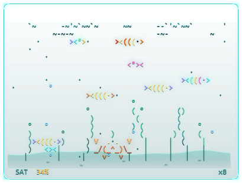
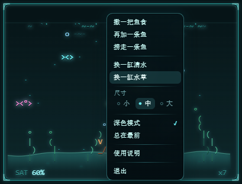

# 赛博鱼缸 · ASCII Cyber Aquarium

浮在 Windows 桌面上的 ASCII 鱼缸桌宠：无边框、无标题栏、背景全透明——桌面上只看得见字符和那圈辉光。Electron + Canvas 2D，55×22 个字符格，15fps。



`v1.1.1` · MIT · Windows 10/11 x64 · [Releases](https://github.com/PanXingcheng01/cyber-aquarium/releases) · [说明书](说明书.html)

## 下载与上手

> 不想看代码，只想养鱼：按下面四步走。

1. 打开 [Releases](https://github.com/PanXingcheng01/cyber-aquarium/releases)，在 **Assets** 里下载 `CyberAquarium-v1.1.1-portable.zip`（约 130 MB）。
   - **不要下 `Source code`**，那是源码快照，不能直接玩。
2. 解压到**纯英文路径**，例如 `D:\CyberAquarium`。
   - 路径里只要有中文（或其它非英文字符），Electron 会直接崩溃；启动器会先弹窗提醒。
3. 双击 `赛博鱼缸.exe`。
   - 第一次启动 SAT 只有 4%，右键 →「撒一把鱼食」；想从头养就删掉 `%APPDATA%\cyber-aquarium\state.json`。
4. 玩法看包里的 **`说明书.html`**（图文、带目录，双击即开）和 **`使用说明.txt`**（一页纸 / FAQ）。

系统要求：Windows 10 / 11（64 位）；不用装 Node、不用联网、不需要管理员权限。程序没有数字签名，首次运行 SmartScreen 提示时选「更多信息 → 仍要运行」。

## 开发环境

程序本体在 `cyber-aquarium/`，Electron 运行时单独放——**exe 所在整条路径必须是纯英文**。

```bat
git clone https://github.com/PanXingcheng01/cyber-aquarium.git
cd cyber-aquarium
```

1. 下载 Electron 45.x win32-x64，解压到 `runtime\`（能看到 `runtime\electron.exe` 即正确）。该目录约 285 MB，已在 `.gitignore` 中排除。
2. 不想放在项目里，就设环境变量 `AQ_RUNTIME` 指向别处的 runtime（同样必须纯英文）。
3. 启动方式：
   - 双击根目录 `赛博鱼缸.exe`（启动器，自动找 `runtime\` 和 `app\` / `cyber-aquarium\`）
   - `tools\启动赛博鱼缸-调试.cmd`（保留控制台，能看到 Electron 报错）
   - `runtime\electron.exe cyber-aquarium`（直接启动程序本体）

## 代码结构

```text
cyber-aquarium/                  # 仓库根
├── cyber-aquarium/              # 程序本体（打包后改名为 app/）
│   ├── main.js                  # 主进程：窗口、拖动、尺寸、存档、IPC、截图/自检
│   ├── preload.js               # contextBridge → window.aq
│   └── renderer/
│       ├── index.html
│       ├── style.css            # 透明背景、辉光、菜单
│       └── app.js               # 模型、step、draw、输入、菜单
├── tools/
│   ├── launcher.cs              # 启动器源码（csc 编译进 赛博鱼缸.exe）
│   ├── 重新打包.cmd              # 版本注入、runtime 瘦身、打 zip
│   └── 启动赛博鱼缸-调试.cmd
├── assets/aquarium.ico
├── shots/                       # README 截图
├── 说明书.html                  # 玩家图文说明
├── 使用说明.txt                  # 玩家一页纸
├── runtime/                     # Electron 45.3.2（gitignore）
```

| 文件 | 职责 |
| --- | --- |
| `main.js` | 透明/无边框/置顶窗口、拖动与越界保护、尺寸切换、`state.json` 读写、菜单 IPC、截图与自检 |
| `preload.js` | `contextBridge` 暴露 `window.aq`：`load/save/dragStart/dragEnd/setSize/setTheme/setTop/openManual/quit` |
| `renderer/app.js` | 整个模拟与绘制：鱼/螃蟹/水草/鱼食/气泡/爱心、`step`、`draw`、输入手势、菜单 DOM |
| `renderer/style.css` | 透明外壳、辉光、菜单样式 |
| `tools/launcher.cs` | 启动器：找 runtime 和 app、检查纯英文路径、启动 Electron |
| `tools/重新打包.cmd` | 版本号注入、runtime 瘦身、打 zip、归档旧版 |

IPC 通道：

| 通道 | 方向 | 作用 |
| --- | --- | --- |
| `aq:load` / `aq:save` | renderer → main | 读 / 写存档 |
| `aq:drag-start` / `aq:drag-end` | renderer → main | 拖动开始 / 结束（主进程用 `setBounds` 跟指针） |
| `aq:set-size` / `aq:theme` / `aq:top` | renderer → main | 尺寸 / 深色外壳 / 置顶 |
| `aq:manual` / `aq:quit` | renderer → main | 打开说明书 / 退出 |

## 运行与存档

存档在 `%APPDATA%\cyber-aquarium\state.json`：

```json
{
  "x": 0, "y": 0,
  "size": "medium", "theme": "clear",
  "satiety": 72, "fishCount": 3,
  "alwaysOnTop": true, "savedAt": 0
}
```

- 每 5 秒自动保存一次；页面隐藏和 `beforeunload` 时也会保存。
- 饱食度按真实时间衰减：`100 / (5 * 3600)` 每秒，满 100 约 5 小时归零；启动时按 `savedAt` 补算离线衰减。
- 首次启动（没有存档）：SAT=4、3 条鱼、medium、透明外壳、置顶。
- 窗口位置和尺寸也在这里；删掉文件即恢复默认。

## 行为模型

每帧 `step(dt)` 更新鱼、螃蟹、鱼食、气泡、水草、爱心；`draw()` 把字符网格画到 canvas。所有鱼的动作都乘 `FISH_SPEED = 0.85`。

### 鱼的状态

| 状态 | 权重 / 时长 | 行为 |
| --- | --- | --- |
| `cruise` | 5 / 4~10s | 巡航，`targetY` 以 0.8 格/s 追赶 |
| `idle` | 3 / 1.6~4.2s | 原地浮沉 |
| `burst` | 2 / 0.9~2.2s | 速度 ×2.9 |
| `sleep` | 2 / 7~16s | 悬停或贴沙面，头顶飘 `z`；喂食、鼠标、点击都能叫醒 |

### 性格（对鼠标）

| `temper` | 触发 | 反应 |
| --- | --- | --- |
| `shy` 胆小 | 光标 5.5 格内 | 反向逃，2.1×base，边跑边冒泡 |
| `still` 好奇 | 光标静止 ≥1.8s 且 11 格内 | 绕着光标转，轨道 3.4 格 |
| `calm` 被动 | 光标 0.7s 内动过且 6.5 格内 | 慢慢靠近，0.4×base |
| `clown` 小丑鱼 | 14 格内 | 一直跟着，轨道 2.2 格；逗螃蟹时会退开 |

### 饥饿

| 档位 | SAT | 游速 | 追食 | 表现 |
| --- | --- | --- | --- | --- |
| 正常 | ≥40 | ×1.0 | ×1.9 | 无 |
| 饿 | <40 | ×0.9 | ×2.2 | 偶尔冒 `…`，颜色偏土黄 |
| 很饿 | <15 | ×0.65 | ×2.6 | 常冒 `…`，SAT<5 变 `!`，颜色偏红 |
| 饿坏 | ≤0.01 | ×0.45 | ×3.0 | 头顶 `!`、贴底打蔫、底栏闪红 |

- 吃一颗鱼食 SAT +1，吃完歇 `6~12s`，期间不抢食。
- 食欲 = `(1 - SAT/100) × 贪吃系数`；SAT≥99 不吃，SAT<15 全缸都来。
- 贪吃系数：小丑 1.25 / 好奇 1.0 / 被动 0.95 / 胆小 0.8，再乘个体随机。

### 螃蟹

| 心情 | 权重 | 速度 |
| --- | --- | --- |
| 睡觉 | 32% | 0，蹲在沙面，脚收起、钳子合上 |
| 自己溜达 | 44% | 0.75 格/s（兴奋 1.25） |
| 跟着你 | 15%（光标 12 格内） | 2.0 格/s |
| 躲开你 | 9%（光标 12 格内） | 3.4 格/s |

- 只会横着走，活动范围 1.5~43.5 格。
- 点它 → 夹人（`pinch` 0.75s）→ 横着窜开；它不吃鱼食。
- 鱼贴着沙面过来时有概率让路（`yieldToFish`）；睡着时概率很低。
- 逗螃蟹时小丑鱼会退开，不抢戏（`teasingCrab`）。

### 交互手势

| 手势 | 判定 | 结果 |
| --- | --- | --- |
| 点击水面 | 按下/松开位移 <4px，且没点到鱼/蟹 | 撒 1~3 颗鱼食 |
| 点击鱼 | 命中鱼身 | 惊吓：闪白 + 3.2×base 窜开 + 拖气泡 |
| 点击螃蟹 | 命中螃蟹 | 夹人 + 闪黄 + 窜开 |
| 按住拖动 | 位移 ≥4px | 拖动整个窗口（主进程 `setBounds`） |
| 停在鱼身上 | 静止 ≥ `PET.dwell`（0.45~0.85s） | 抚摸：鱼停下、冒 `♥`；睡着的鱼点一下才醒 |
| 右键 | `contextmenu` | 打开菜单 |

### 碰撞

- 鱼×鱼 `0.55s`，鱼×蟹 `0.6s`，各自让开半个身位，纵向 1.15 格/s。
- 冷却 3 秒；触发是每帧概率（`dt×5` / `dt×4`），不是一碰就弹。

## 渲染与界面

- 网格 55×22；medium 每格 7×13px，窗口 409×310；small 352×264，large 523×402。
- 画布保持透明，字符按网格 `put()` 进缓冲区再统一绘制；辉光只作用在鱼的字符上。
- 水面在水的第一行，第二行留波峰；水面以上是纯透明空气。
- 底栏左边 `SAT xx%`，右边鱼数；深色模式在画布下铺 `#061417`，画布本身仍透明。
- 帧率 15fps；空闲时约单核 19%、内存约 340MB（Electron 地板）。

<details>
<summary>界面截图（主图之外 8 张）</summary>

| | | |
| --- | --- | --- |
|  |  |  |
|  |  |  |
|  |  | |

</details>

## 关键参数

改之前先看这里；**代码是唯一事实来源**，下表只是入口。

| 想改 | 位置 |
| --- | --- |
| 鱼种、颜色、基础速度 | `renderer/app.js` 的 `KINDS` / `CLOWN` |
| 整体鱼速 | `FISH_SPEED`（0.85） |
| 鱼的状态权重 / 时长 | `FISH_MODES` |
| 性格阈值与反应 | `stepCursorPull()` |
| 饥饿阈值 / 游速 / 追食 | `HUNGER` / `HUNGER_SPEED` / `CHASE_SPEED` |
| 食欲、贪吃、消化 | `APPETITE` / `GREED` / `DIGEST` |
| 饱食度衰减 | `step()` 里的 `100 / (5 * 3600)` |
| 鱼食下沉 / 寿命 / 上限 | `spawnPellet()` / `stepPellets()` |
| 抚摸门槛 / 爱心 | `PET` / `HEART` |
| 螃蟹行为 / 速度 | `CRAB` / `pickCrabMode()` / `stepCrab()` |
| 受惊 / 碰撞 | `stepFish()` / `stepBumps()` |
| 格子 / 窗口尺寸 | `main.js` 的 `LAYOUT` |
| 拖动阈值 | `DRAG_SQ`（16 = 4px） |
| 存档间隔 | `startAutosave()`（5000ms） |

当前常用值：

| 参数 | 值 |
| --- | --- |
| 帧率 | `FRAME_MS = 1000/15`（15fps） |
| 网格 | 55 × 22 |
| 窗口 | 352×264 / 409×310 / 523×402 |
| 整体鱼速 | `FISH_SPEED = 0.85` |
| 鱼数 | 1~8 |
| 鱼食 | 下沉 1.6 格/s，寿命 45s，上限 24 颗 |
| 饥饿衰减 | 100 / (5×3600) 每秒，约 5 小时归零 |
| 存档 | 每 5s |
| 菜单项 | 10 组（`MENU_ITEMS`，尺寸行展开为 3 个按钮，DOM 共 12 个） |

## 开发自检

```cmd
:: 交互回归（当前 43 项，必须全绿；--selftest 必须配合 --capture 才会执行）
runtime\electron.exe cyber-aquarium --selftest --capture=shots\test.png

:: 截图（保留 alpha；--force-device-scale-factor=1 让输出稳定）
runtime\electron.exe --force-device-scale-factor=1 cyber-aquarium --size=medium --dark --rescape --capture=shots\tmp.png

:: 字体/墨迹、字符网格、帧率
runtime\electron.exe cyber-aquarium --probe
runtime\electron.exe cyber-aquarium --dump
runtime\electron.exe cyber-aquarium --fps
```

> `--selftest` 写在截图流程里：不带 `--capture` 时它不会执行，窗口会一直开着。要跑回归就照上面的命令带一个 `--capture`。
> 输出里的 43 个布尔断言都应符合预期；其中 `menuAfterSecondRightClick=false` 是预期值（第二次右键应关闭菜单）。
> 跑之前先关掉正在运行的鱼缸：程序有单实例锁，第二次启动会直接退出，看起来像“什么都没发生”。

验收 / 截图开关（`main.js` 顶部解析）：

| 开关 | 作用 |
| --- | --- |
| `--selftest` | 合成事件跑交互回归（需配合 `--capture`） |
| `--capture=<png>` / `--wait=<ms>` | 截图后退出 / 截图前等待 |
| `--size=small\|medium\|large` | 启动尺寸 |
| `--sat=<0-100>` / `--hungry` | 设置饱食度 / 清零 |
| `--feed` / `--pet` / `--menu` | 撒食 / 光标停鱼身 / 打开菜单 |
| `--crab` / `--crabsleep` / `--crabclear` | 螃蟹夹人 / 睡姿 / 只拍螃蟹 |
| `--rescape` / `--water` | 换草 / 换水 |
| `--dark` / `--light` / `--clear` | 深色 / 透明（`--light` 与 `--clear` 等同） |
| `--sleep` / `--top` / `--fish=<n>` | 鱼睡觉 / 浮到水面 / 加到 n 条 |
| `--probe` / `--fps` / `--dump` | 字体墨迹 / 实测帧率 / 字符网格 |
| `--sizetest` / `--snaptest` | 尺寸切换 / 贴边不吸附（内部回归） |

## 打包与发布

### 构建

```cmd
:: 先关掉正在运行的鱼缸，否则 exe 被占用，启动器编译失败
cmd /c tools\重新打包.cmd build
```

脚本会重新编译启动器、精简 runtime，生成带版本号的 portable zip。

### 版本更新规则

- 版本号**唯一来源**：`cyber-aquarium/package.json` 的 `version`。zip 名、`赛博鱼缸.exe` 文件属性、Release tag 自动一致，不要手改 exe。
- 级别：`z` = 只调手感 / 修 bug / 改文案；`y` = 加了能感知的新功能；`x` = 整体重做 / 不兼容。

| 变化 | 页面 | 说明 |
| --- | --- | --- |
| `z` 补丁 | **删旧页和 tag**，新建 | 列出这条 y 线的全部 z |
| `y` 次版本 | 旧页保留，另开 | 只写本版 |
| `x` 大版本 | 旧页保留，另开 | 只写本版 |

- `v1.0.0` 是首个版本，永久保留。
- 发布顺序：改 version → 同步 README 下载文件名 / `说明书.html` 页脚（页脚只写 x.y）→ 自检 → 打包 → 解压到纯英文路径实测 → Release / 上传 / 核对 sha256。
- Release 正文写清「下载 Assets 里的 zip，不是 Source code」「解压到纯英文路径」「首次启动 SAT=4」。

## 已知限制

- **Electron 运行时整条路径必须纯英文**：含中文会直接崩（退出码 `0x80000003`，连 `--version` 都出不来）。
- **拖动必须 `setBounds`（带尺寸）**：只调 `setPosition` 在 175% 缩放下会让窗口每次长 1~2px，越拖越大。
- `resizable:false` 时 Electron 会静默忽略 `setSize`：切尺寸要临时允许缩放，改完再关回去。
- 窗口是矩形，四个圆角外的透明区域仍会接住点击（没有逐像素穿透）。
- 没有托盘图标，退出走右键菜单。
- 透明窗口下不要用纯白字符，浅色壁纸上会“消失”；小丑鱼白条用暖米黄，眼睛用深色。

## License

代码以 MIT 发布（见 `LICENSE`）。Electron / Chromium 运行时单独准备，不随仓库分发；相关许可见它们自己的 `LICENSE`、`LICENSES.chromium.html`。
